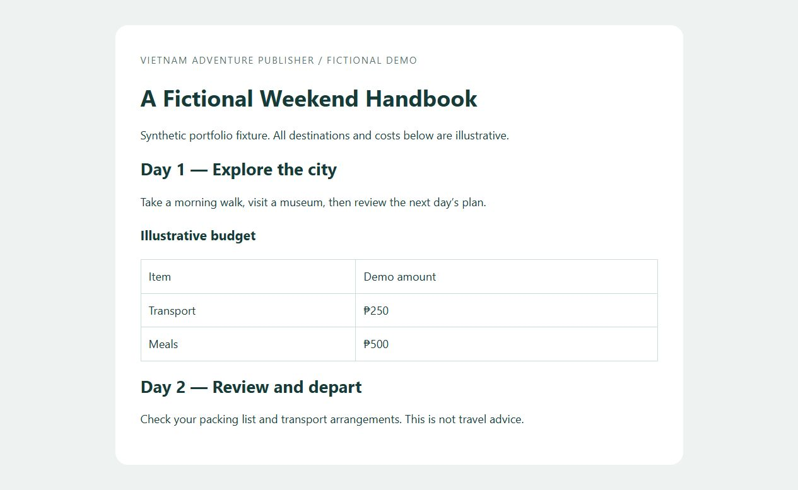

# Vietnam Adventure Publisher

A Python document-processing project with a runnable **DOCX → HTML + JSON** portfolio pipeline. The example uses a generated fictional handbook, so you do not need the personal travel documents stored in the legacy source folder.



## Run the portfolio demo

Requires Python 3.10+ and `python-docx`. Run commands from the repository root. On Windows, use `py` instead of `python` if that is your Python launcher.

```sh
python -m venv .venv
```

Activate on Windows PowerShell with `.venv\Scripts\Activate.ps1`, or on macOS/Linux with `source .venv/bin/activate`. Then:

```sh
python -m pip install -r requirements.txt
python examples/make_demo.py
python -m vap.main examples/demo.docx --output-dir output/demo
python -m unittest discover -s tests -v
```

Open **output/demo/demo.html** in a browser. The command also creates `demo.json`. Expected result: **8 content blocks**, including two day headings and an illustrative budget table. The sample generator refuses to replace an existing `examples/demo.docx`; reuse it on subsequent runs. Choose a fresh output directory to run the publisher again.

For your own document:

```sh
python -m vap.main path/to/document.docx --output-dir output/my-document
```

Files stay local. No external API or model is used. Review generated content before publishing it elsewhere.

## What works

- Reads `.docx` paragraph text, Word heading styles and table cell text.
- Preserves the order of top-level paragraphs and tables.
- Exports Unicode JSON plus a self-contained responsive HTML reading view.
- Escapes document text before inserting it into HTML.
- Rejects missing/invalid files and refuses existing output paths.
- Tests mixed content order, Unicode, HTML escaping and repeat-run protection.

## Project structure and status

| Path | Purpose / status |
| --- | --- |
| `vap/main.py` | Runnable command-line entry point |
| `vap/portfolio.py` | Implemented extraction and HTML/JSON export |
| `examples/make_demo.py` | Creates a fictional input fixture |
| `tests/test_portfolio.py` | Focused pipeline checks |
| `vap/parser`, `vap/semantic`, `vap/publishing` | Earlier architecture; several components remain placeholders |
| `handbook/source` | Legacy input documents; not required by this demo |

The portfolio path is independent of the incomplete semantic architecture. The original `DocxParser` expects missing `Handbook`/`Chapter` implementations and is not the demonstrated entry point. This project does **not** yet reproduce full Word formatting, images, headers/footers, footnotes, nested tables, semantic chapter boundaries or PDF/Word publishing. The table exporter represents merged cells as returned by `python-docx`; it does not preserve spans. Process trusted documents of reasonable size; this is not a hardened upload service.

## Contribution and AI assistance

**Ronnel Patubo** owns the project and supplied the original handbook context and requirements. This portfolio pass was requested to make the work reproducible and easier for prospective clients to assess.

**Codex assistance:** the new runnable CLI, fixture generator, tests, documentation and screenshot were authored/produced with AI assistance. Earlier repository code has not been attributed line by line. No claim is made that Ronnel independently authored every line or that this was paid-client delivery. He should be able to explain and adapt this pipeline when presenting it.

The sample demonstrates document extraction, input validation and reviewable publishing. It does not imply travel expertise, customer outcomes or production readiness. No repository license has been assigned; ask the owner before reusing the code.

Related: [Ronnel's practical software samples](https://github.com/ronnel0716/Hello-to-me).
